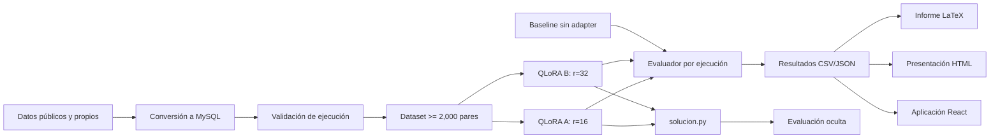

<div align="center">

# Texto a SQL con QLoRA

### Proyecto 3 - Deep Learning y Sistemas Inteligentes

**Universidad del Valle de Guatemala · Sección 30 · 2026**

[](#estado-del-proyecto)
[](#decisiones-t%C3%A9cnicas)
[](#restricciones-no-negociables)
[](LICENSE)

**Wilson Alejandro Calderón Argueta · 22018**<br>
**Pablo Daniel Barillas Moreno · 22193**

</div>

---

## Qué estamos construyendo

Un sistema reproducible de **Text-to-SQL en español** que recibe el esquema de una base de datos y una pregunta, y genera una única consulta compatible con MySQL 8.4.10. El núcleo del proyecto es el fine-tuning de `Qwen/Qwen2.5-Coder-1.5B-Instruct` mediante QLoRA; el resultado se evaluará por exactitud de ejecución sobre bases y preguntas ocultas.

La aplicación React es una capa de demostración y análisis. No sustituye ni modifica el contrato oficial de `solucion.py`, y no usa servicios externos para generar SQL.

> **Entrega:** domingo 25 de octubre de 2026, 23:59 (America/Guatemala).<br>
> **Formato oficial:** repositorio privado en GitHub; en Canvas, repositorio comprimido y PDF de la presentación.

## Navegación

| Documento | Propósito |
|---|---|
| [Plan de ejecución](docs/PLAN_PROYECTO.md) | Decisiones, fases, calendario, métricas, riesgos y definición de terminado |
| [Handoff para v0](docs/HANDOFF_V0.md) | Contexto completo y prompt listo para generar la aplicación React |
| [Enunciado original](docs/enunciado/Proyecto_3_Texto_a_SQL.pdf) | Fuente autoritativa de requisitos del curso |
| [Informe LaTeX](informe/main.tex) | Esqueleto estético del informe técnico |
| [Presentación HTML](presentacion/index.html) | Fuente imprimible de la presentación de hasta 12 diapositivas |
| [Bitácora](BITACORA.md) | Registro cronológico de trabajo; requiere al menos 8 entradas reales |
| [Contribuciones](CONTRIBUCIONES.md) | Responsables y evidencia verificable |

## Decisiones técnicas

| Área | Decisión inicial | Razón |
|---|---|---|
| Modelo base | `Qwen/Qwen2.5-Coder-1.5B-Instruct` | Es la opción recomendada por el enunciado y cabe en una T4 con cuantización |
| Ajuste | QLoRA de 4 bits, NF4, cómputo FP16 | Reduce memoria y es compatible con GPU T4 |
| Comparación LoRA | A: rango 16; B: rango 32 | Cambia un solo factor: `r`; todo lo demás permanece fijo |
| Motor SQL | `mysql:8.4.10` | Reproduce el entorno oficial, incluido `ONLY_FULL_GROUP_BY` |
| Métrica principal | Exactitud ponderada por ejecución (EX) | Es la métrica de evaluación oculta |
| Experimento de inferencia | Una reparación guiada por `ejecutar` | Aprovecha el contrato oficial sin exceder tres ejecuciones |
| UI | Next.js + React + TypeScript dentro de `web/` | Es la ruta más fiable para v0 y mantiene aislada la entrega Python |
| Visualización | shadcn/ui, Tailwind CSS, Lucide y Recharts | Componentes editables, accesibles y sin dependencia de una API externa |
| Editor SQL | CodeMirror cargado de forma diferida | Resaltado SQL sin incluir un IDE pesado en el bundle inicial |

## Restricciones no negociables

- El valor devuelto por `generar_sql(esquema, pregunta, ejecutar=None)` será **una sola** consulta `SELECT` o `WITH ... SELECT`.
- El modelo se cargará desde `config.json`; `usar_adapter: false` deberá ejecutar el mismo prompt sin adapter.
- La generación será determinista (`do_sample=False` y semilla `2026`).
- Tiempo máximo: 5 minutos de carga y 30 segundos por pregunta.
- No se utilizarán APIs externas durante la generación evaluada.
- Solo se aceptarán pares de entrenamiento cuya consulta ejecute sin error en MySQL 8.4.10.
- Entrenamiento y validación se separarán por esquema, nunca por pregunta.
- Los esquemas de validación no aparecerán en entrenamiento.
- La salida se validará como lectura; se rechazarán DDL, DML y múltiples sentencias.
- La app web será opcional y no se importará desde `solucion.py`.

## Arquitectura prevista



La frontera importante es `solucion.py`: ni la aplicación React ni su backend opcional forman parte de la ruta que utilizará el docente.

## Estructura del repositorio

```text
.
├── adapter/                    # Adapter QLoRA final y metadatos
├── backend/                    # API local opcional para la demo React
├── datos/
│   ├── entrenamiento/         # Pares aceptados, separados por esquema
│   ├── validacion/            # 2+ esquemas inéditos y 40 preguntas propias
│   ├── descartes/             # Pares rechazados y motivo auditable
│   └── esquemas/              # DDL, semillas y metadatos de esquemas
├── docs/
│   ├── enunciado/             # PDF original del proyecto
│   ├── HANDOFF_V0.md
│   └── PLAN_PROYECTO.md
├── informe/
│   └── main.tex               # Fuente del informe
├── notebooks/                 # Datos, entrenamiento y evaluación
├── presentacion/
│   └── index.html             # Fuente; se exportará a presentacion.pdf
├── resultados/                # Métricas, curvas y validacion_propia.csv
├── scripts/                   # Automatización reproducible
├── tests/                     # Contrato, seguridad SQL y evaluación
├── web/                       # Aplicación Next.js/React generada con v0
├── BITACORA.md
├── CONTRIBUCIONES.md
├── config.json
├── solucion.py                # Se implementará en la fase de inferencia
└── requirements.txt           # Se fijará tras validar en Colab T4
```

Los archivos todavía no implementados aparecen en el árbol porque son entregables obligatorios, no porque ya estén completos.

## Flujo experimental

1. Reunir y normalizar más de 2,500 candidatos para conservar al menos 2,000 pares válidos.
2. Convertir todo SQL al dialecto MySQL y ejecutarlo en MySQL 8.4.10.
3. Deduplicar por esquema, pregunta normalizada y SQL normalizado.
4. Congelar dos esquemas de validación antes de entrenar y escribir 40 preguntas propias balanceadas.
5. Medir el baseline con exactamente el mismo prompt de inferencia.
6. Entrenar QLoRA A (`r=16`) y QLoRA B (`r=32`) con la misma semilla y demás hiperparámetros.
7. Seleccionar el adapter por EX ponderada, no por loss de entrenamiento.
8. Comparar inferencia directa contra una reparación guiada por ejecución.
9. Clasificar errores en sintaxis, entidad inexistente, JOIN, agregación, filtro y resultado distinto.
10. Repetir la instalación y evaluación desde cero en Google Colab con GPU T4.

Los criterios cuantitativos y el calendario diario están en el [plan de ejecución](docs/PLAN_PROYECTO.md).

## Ejecución

Los comandos definitivos se documentarán cuando cada ruta haya sido probada desde un entorno limpio. El objetivo de la interfaz será:

```bash
# Entorno evaluable
pip install -r requirements.txt
python -m pytest

# Aplicación React opcional
cd web
pnpm install --frozen-lockfile
pnpm dev
```

No se publicarán comandos provisionales que aparenten reproducibilidad antes de haberlos validado en T4 y MySQL 8.4.10.

## Evaluación y metas internas

| Indicador | Mínimo del enunciado | Meta interna |
|---|---:|---:|
| Pares válidos de entrenamiento | 2,000 | 2,300+ después de filtros |
| Esquemas propios para datos generados | 10 | 12 |
| Esquemas inéditos de validación | 2 | 2, completamente congelados |
| Preguntas propias de validación | 40 | 40: 14 fáciles, 14 medias, 12 difíciles |
| EX con adapter | Sin mínimo obligatorio | >= 0.70 |
| Mejora frente al baseline | Sin mínimo obligatorio | >= 0.15 |
| Consultas no deterministas o mutables | 0 | 0 |

## Colaboración

- **Wilson Alejandro Calderón Argueta:** propietario de datos y validación SQL; evidencia en scripts, descartes y commits.
- **Pablo Daniel Barillas Moreno:** propietario de entrenamiento e integración de inferencia; evidencia en notebooks, adapters y commits.
- **Ambos:** validación propia, análisis de errores, revisión cruzada, informe y presentación.

Cada integrante debe hacer commits desde su propia cuenta. No se atribuirán a una persona cambios hechos por otra ni por una herramienta automática. Antes de entregar se generará:

```bash
git log --all --date=iso --stat > historial_git.txt
```

## Licencias y uso de IA

El código propio se distribuye bajo [MIT](LICENSE). Las dependencias se registrarán con nombre, versión y licencia antes de la entrega. La propuesta web usa proyectos permisivos: React y Next.js (MIT), Tailwind CSS (MIT), shadcn/ui (MIT), Recharts (MIT), CodeMirror (MIT) y Lucide (ISC).

Se utilizó **OpenAI Codex** para analizar el enunciado, proponer el plan, crear la estructura documental y preparar el handoff de UI. Se prevé utilizar **v0 de Vercel** para generar y refinar la aplicación React. Todo código, dato sintético y texto generado por IA deberá ser revisado, ejecutado y validado por el equipo. No se usará ninguna API de IA en la ruta de inferencia evaluada.

## Estado del proyecto

- [x] Enunciado leído, extraído y revisado visualmente.
- [x] Decisiones técnicas iniciales y plan de riesgos.
- [x] Estructura del repositorio y handoff para v0.
- [x] Esqueletos de informe y presentación.
- [ ] Dataset validado en MySQL 8.4.10.
- [ ] Baseline reproducible.
- [ ] Dos configuraciones QLoRA entrenadas.
- [ ] Experimento de inferencia y análisis de errores.
- [ ] Validación limpia en Colab T4.
- [ ] Adapter, PDF final y paquete de entrega.

---

<div align="center">
Trabajo académico de la Universidad del Valle de Guatemala · Deep Learning y Sistemas Inteligentes · Sección 30
</div>
